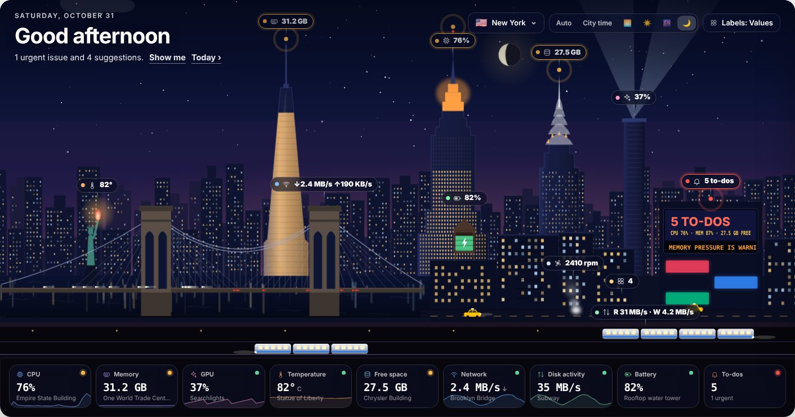

# diskmap

**A live dashboard for your Mac, drawn as a city.** Every landmark is one of your Mac's stats: the Empire State lights up
with CPU load, One World Trade fills up with memory, the subway trains carry your disk reads and writes. Click anything
for details and one-click fixes: quit the app that's eating memory, clear gigabytes of caches, close duplicate tabs.



Free, private and runs only on your Mac. Nothing is quit, deleted or changed until you click and confirm it.

---

## Install (about 2 minutes)

1. Open **Terminal**: press **⌘ Space**, type `Terminal`, press **Return**.
2. Copy this line, paste it into Terminal and press **Return**:

   ```bash
   curl -fsSL https://raw.githubusercontent.com/muhamrif/diskmap/main/install.sh | bash
   ```

3. diskmap opens by itself. It's in your **Applications** folder from now on.

Works on any Mac with **macOS 12 Monterey or newer**, Apple silicon or Intel. You don't need Python, Xcode or anything
else; everything diskmap needs is inside the app.

### First time you open it

macOS asks permission for a few things. They're all optional, but each one unlocks part of diskmap:

| Permission | Where | What it unlocks |
|---|---|---|
| **Full Disk Access** | System Settings › Privacy & Security › Full Disk Access › turn on **diskmap** (if it's not listed, click **+** and pick it from Applications). Then quit diskmap from its menu bar icon and open it again. | The complete disk map and cleanup suggestions |
| **Automation** | Click **Allow** when diskmap asks to control Safari, Chrome, Finder or System Events | Closing browser tabs, moving files to the Trash, login items |
| **Notifications** | Click **Allow** when asked | Alerts like "Disk almost full" with a fix button |

Open the **Diagnostics** tab any time: it shows what's working and has a button for anything that isn't.

### Prefer not to use Terminal?

1. Go to the [latest release](https://github.com/muhamrif/diskmap/releases/latest) and download
   **diskmap-macos-arm64.zip** (Apple silicon: M1, M2, M3, M4…) or **diskmap-macos-x86_64.zip** (older Intel Macs).
   Not sure which? Apple menu  › About This Mac › Chip/Processor.
2. Double-click the zip, then drag **diskmap** into your **Applications** folder.
3. Open it. macOS will say it can't check the app. diskmap is a free personal project that isn't registered with Apple,
   so this is expected. Click **Done**, then go to **System Settings › Privacy & Security**, scroll down and click
   **Open Anyway** next to "diskmap was blocked", and confirm with your password.

You'll have to repeat step 3 after each update this way, which is why the Terminal install is easier.

### Update

diskmap tells you when a new version is out (a notification, and a card in the Live tab's suggestions). To update, paste the same install
command into Terminal again. Your history and settings are kept.

### Uninstall

```bash
curl -fsSL https://raw.githubusercontent.com/muhamrif/diskmap/main/install.sh | bash -s -- --uninstall
```

That removes the app and keeps your history in case you come back. To delete the history too, use `--purge` instead of
`--uninstall`.

### Something's not right?

- **"diskmap stopped"**: click **Restart**. If it keeps happening, run the install command again.
- **The disk map is incomplete after an update**: macOS sometimes forgets Full Disk Access for a new version. In
  System Settings › Privacy & Security › Full Disk Access, turn diskmap off and on again, then reopen diskmap.
- **"Terminal was prevented from modifying apps"**: System Settings › Privacy & Security › App Management, turn on
  Terminal, then run the install command again.
- **"Couldn't reach GitHub"**: check your internet connection, VPN or firewall and try again.
- **Some sensors say "n/a" on an Intel Mac**: GPU usage and a few temperature and power readings only exist on Apple silicon.
- **Anything else**: Diagnostics tab › **Copy report**, and send it to whoever shared diskmap with you.

### Privacy

diskmap runs a small dashboard server on your Mac that only your Mac can reach, protected by a password that changes
every launch. Your files, stats and history never leave your computer. The only things diskmap ever fetches from the
internet are a once-a-day check for a new version on GitHub (turn it off in Settings) and, if you switch it on, your
public IP address. Files you clean up go to the Trash, so you can put them back.

---

## What's inside

### City (the main page)

Pick a city with the button at the top right (or press `[` / `]`): **New York, Dubai, Karachi, Paris, London, Tokyo**.

| Stat | New York | Dubai | Karachi | Paris | London | Tokyo |
|---|---|---|---|---|---|---|
| CPU (floors light up) | Empire State | Burj Khalifa | Bahria Icon Tower | Eiffel Tower (sparkles above 70%) | The Shard | Skytree |
| Memory (glass fills) | One WTC | Burj Al Arab | Habib Bank Plaza | Tour Montparnasse | The Gherkin | Cocoon Tower |
| Free disk (lit lights) | Chrysler crown | Dubai Frame | MCB Tower | Arc de Triomphe | Big Ben's dial | Tokyo Tower |
| GPU | Searchlights | Museum of the Future | Mazar-e-Quaid floodlights | Eiffel beacon | London Eye | Neon signs |
| Temperature | Liberty's torch | Emirates Towers | Teen Talwar | Sacré-Cœur | St Paul's | Mt Fuji turns red |
| Network (headlights ↓ / taillights ↑) | Brooklyn Bridge | Sheikh Zayed Road | Native Jetty Bridge | Pont Alexandre III | Tower Bridge | Rainbow Bridge |
| Battery | Water tower | Wind tower | Clock tower | Moulin Rouge | Phone box | Vending machine |
| Fans | Manhole steam | Dubai Fountain | Chai steam | Trocadéro fountains | Battersea smoke | Ramen steam |

Trains underground carry disk reads and writes, the vehicles are your open apps, and the big screen counts your to-dos.
Anything in trouble gets a pulsing ring. Hover a landmark to see its value; click it for history, details, the apps
responsible and fix buttons. The sky follows your clock (or the city's), with tonight's real moon phase.

### Tabs

| Tab | What's there |
|---|---|
| **Today** | The rundown: what needs attention, focus modes, apps whose memory keeps growing, storage, your week, battery health |
| **Live** | CPU, GPU, memory, disk, temperature, power, network and disk activity; every suggested fix; apps by memory, CPU or energy with Quit |
| **Processes** | Every process with search, Stop and Kill; browser tabs (close duplicates or heavy ones); what's keeping the Mac awake |
| **Hardware** | Per-core load, power by component, fans, every temperature sensor, battery health and cycles, Bluetooth and USB devices |
| **Network** | Wi-Fi, ping, apps using the network, open connections, DNS, VPN, listening ports, sharing services |
| **Storage** | The disk map (treemap) with safe cleanup, biggest files, likely duplicates, volumes, Time Machine |
| **Software** | Every app with size, last opened and Intel-only flag; macOS and Homebrew updates; login items and leftovers |
| **Security** | FileVault, firewall, Gatekeeper, SIP, screen lock, sharing, Find My, with a score and fix buttons |
| **Developer** | Git repos with unpushed work, toolchain versions, Docker, local AI models, maintenance tasks |
| **History** | Charts of everything over 1 hour to 30 days, busiest apps, alerts and cleanups |
| **Logs** | Crashes, hangs, sleep and wake history |

Plus: a menu bar item with live CPU and temperature, notifications with fix buttons, a **⌘K** command bar, a desktop
widget, focus modes that quit distracting apps and bring them back, a weekly digest, a large-file watcher, light and
dark mode, and an optional autopilot (off by default).

Keyboard: ⌘1 City, ⌘2 Today, ⌘3 Live … ⌘9 History · ⌘K command bar · ⌘] / ⌘[ next / previous city · ⇧⌘R restart the dashboard.

---

## For developers

Everything is the Python standard library (3.9+) plus one Swift file. No pip, no npm.

```bash
git clone https://github.com/muhamrif/diskmap && cd diskmap
python3 server.py                   # the dashboard in your browser at http://127.0.0.1:7777
bash macapp/build.sh                # build the Mac app (Python built in) and install it to ~/Applications
bash tests/smoke.sh                 # end-to-end test of the server
bash tests/test_install.sh          # the installer against simulated Macs
```

Building the app needs Apple's Command Line Tools (`xcode-select --install`). See [RELEASING.md](RELEASING.md) for how
releases are built and published.

```
python3 server.py --port 8080         # different port
python3 server.py --rescan-min 0      # only rescan the disk when you click
python3 server.py --lan               # view from your phone on the same Wi-Fi (read-only there)
python3 server.py --demo              # fake data, works on any computer
python3 macstats.py                   # print every hardware sensor reading
python3 inventory.py security apps    # print any inventory section
python3 diskmap.py                    # one-off static disk report
```

**Safety:** the server listens only on 127.0.0.1 (unless `--lan`), checks the Host header, and every action needs a
per-launch token. It re-checks every action itself: it only quits running non-system apps, stops your own processes,
closes tabs it listed, moves to the Trash only files and apps it listed, removes only your own leftover launch agents,
and runs only its own whitelisted maintenance commands.
